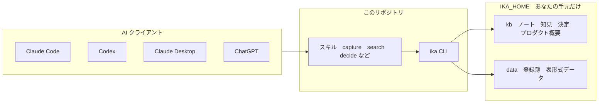

# ika

**調べたこと・決めたことを、AI と一緒に溜めて使うための、個人用ナレッジハーネス。**

調査メモ、ビジネスの知見、技術の判断、意思決定の記録を、ただのテキストファイル（Markdown と CSV）で溜めます。
それを Claude Code / Codex / Claude Desktop / ChatGPT のどれからでも、同じ手順で読み書きできます。

こんなことができます。

- 「前に調べた〜って何だっけ？」に、**根拠にしたファイルのパス付き**で答えてもらう
- 「〜を決めたい」と言うと、**過去のメモを踏まえて**選択肢を整理し、決定を理由つきで記録する
- 開発中のサービスや副業の検討を「プロダクト」として登録し、概要と関連ノートをまとめて見る
- 価格の履歴のような表形式のデータを、SQL で集計する
- 溜めたナレッジを、ブラウザでそのまま読む

## しくみ

このリポジトリは**道具（CLI とスキル）だけ**を持ちます。ナレッジ本体は、あなたの手元の `IKA_HOME` ディレクトリに溜めます。自分の調査メモをリポジトリに混ぜずに済み、書き込みのたびに手元の git で自動コミットされるので、履歴も残ります。



AI は `kb/` や `data/` のファイルを直接いじらず、必ず `ika` コマンドを通します。書式の検証、リンク切れの検出、自動コミットを CLI が一手に引き受けるためです。

### 溜めるもの

| 種類 | 置き場所 | 性質 |
|---|---|---|
| ノート | `kb/<領域>/notes/YYYY/` | 日付つきの生ログ。書いたら原則そのまま |
| 知見 | `kb/<領域>/insights/` | 複数のノートから蒸留したもの。育てて更新する |
| 決定 | `kb/<領域>/decisions/` | 背景・選択肢・決定・理由の記録 |
| プロダクト | `kb/projects/<name>/README.md` | サービスや副業ごとの概要 |
| 要件書 | `kb/projects/<name>/specs/` | 機能ごとの目的・範囲・受け入れ条件。実装したら今の形に直す |
| 取り込んだ資料 | `kb/projects/<name>/sources/`・`kb/<領域>/sources/` | 外部のドキュメントの全文。`ika import` が Rust だけで変換し、取り込み直せる |
| 表データ | `data/datasets.sqlite3` | 件数が増えていく数値や記録。`ika data` で扱う |

領域は最初から `business`（ビジネス・ドメイン知識）と `tech`（技術）に分けてあります。書式の詳細は [`docs/kb-format.md`](docs/kb-format.md) と [`docs/data-format.md`](docs/data-format.md) です。

## はじめる

必要なもの: [Rust](https://rustup.rs/)（1.99 以上）、git、[ripgrep](https://github.com/BurntSushi/ripgrep)（`ika kb grep` で使う）

```bash
# 1. このリポジトリを取得して ika コマンドを入れる
git clone https://github.com/lockhart9/ika.git
cd ika
cargo install --path cli

# 2. ナレッジを置く場所を決めて、シェルの設定（.zshrc など）に足す
export IKA_HOME=~/my-knowledge

# 3. ナレッジベースを作る（手元だけの git リポジトリになる）
ika init
ika check
```

`IKA_HOME` が未設定だと、`ika` の KB 系コマンドは動きません（既定の場所はありません）。

旧構成（KB をこのリポジトリの `kb/`・`data/` に置いていた）から移すときは、`ika init --import <旧リポジトリ>` を使います。

### スキルを AI に入れる

スキルは、AI に「どう記録して、どう探すか」を教える手順書です。ika プラグインとして入れると、どのリポジトリで作業していても使えます。リポジトリの中で実行してください。

```bash
ika install --dry-run   # 何を実行するか確認
ika install             # Claude Code と Codex に登録して入れる
```

`ika install` は、このディレクトリのパスを各クライアントの設定に登録するだけです。外部への公開や送信はしません。

## 使ってみる

スキルは `ika:<名前>` で呼びます（Claude Code なら `/ika:capture` など）。普通に話しかけても、依頼の内容から自動で選ばれます。

| スキル | こう頼む | 何をするか |
|---|---|---|
| `capture` | 「この記事をまとめて KB に残して」 | 情報や知見を、書式を守って記録する |
| `search` | 「前に調べた〜は？」「〜について何を決めたっけ」 | KB を検索し、根拠のパスを添えて答える。無ければ「KB に記録なし」と言う |
| `decide` | 「〜を決めたい」「判断材料を整理して」 | 過去の経緯を踏まえて論点を整理し、決定を記録する |
| `project-add` | 「新しいサービスを始めたので登録して」 | プロダクトを登録し、概要の README を作る |
| `project-sync` | 「〜の現状を KB に反映して」 | リポジトリを読んで、プロダクト概要を最新にする |
| `import` | 「この仕様書を取り込んで」「Notion のページを KB に入れて」 | 外部のドキュメント（リポジトリの Markdown・Drive・Notion・docx・xlsx・pptx・pdf・html）を Markdown にして全文で取り込み、要点を書き起こす |
| `cycle` | 「〜を調べて作って」「次の打ち手を進めて」 | 調査 → 要件 → 実装 → テスト → コミットを回し、各段階の結果を KB に戻す。要件の承認で1回だけ止まる |

CLI を直接使う場合のよく使うコマンドです。全コマンドは [docs/cli.md](docs/cli.md) と `ika --help` で見られます。

```bash
ika new note "タイトル" --domain tech --project <name> --tags a,b --stdin   # ノートを作る（本文は標準入力）
ika kb fts 申請を取り下げたい -d tech        # 全文検索（日本語の形態素解析つき。文でも引け、関連度順）
ika kb search キーワード --any -d tech        # 文字列をそのまま含むかで検索（信頼度順。採用済みの決定が先に出る）
ika capture "メモ"                            # 領域などを決めずに受信箱へ即保存（整理は後で。`ika inbox ls`）
ika kb orphans                                # どこからもリンクされていないノート（蒸留の候補）
ika kb stale                                  # 古くなっていそうなナレッジ（リポジトリより古い README、古い価格・競合を根拠にした決定など）
ika kb triage                                 # 上の2つをまとめ、優先順位つきの「今週やること」にする
ika project add <name> --summary "一行説明"   # プロダクトを登録
ika data sql "select ..."                     # 表形式データを集計
ika check                                     # KB を検証
```

ノートが溜まったら `ika kb orphans` で未整理のものを確認し、複数のノートから言えることを知見（insight）に書き直すのが基本の流れです。

### ブラウザで読む

```bash
ika serve --open   # http://127.0.0.1:8787/ を開く
```

KB を Markdown のままブラウザで読めます。トップ、領域ごとの一覧、プロダクトのページ、検索があり、ノート同士のリンクも辿れます。読み取り専用で、手元の `127.0.0.1` だけで待ち受けます。ファイルは毎回読み直すので、`ika` で書いたあとは再読み込みで見えます。

資料として読むなら、単独の HTML に書き出します。図（シーケンス図・フロー・層・ER 図・クラス図・年表・案の比較）は CSS だけで描き、JavaScript は使いません。

```bash
ika export html kb/projects/foo/specs/bar.md --open   # 1ページ
ika export html --project foo --open                  # プロダクトの README・資料・要件書・決定・知見を1ファイルに
ika export html --all                                 # KB 全体（IKA_HOME/.cache/html/index.html が入口）
```

図の書き方は [docs/diagrams.md](docs/diagrams.md)。見た目は `IKA_HOME/theme/style.css` で色・フォントの変数を上書きできます。

<details>
<summary>セキュリティ上の挙動（クリックで開く）</summary>

- GET と HEAD しか受け付けません
- Host が `localhost`・`127.0.0.1` 以外のリクエストは断ります（DNS リバインディング対策）
- KB の外やシンボリックリンク経由は読めません。返すのは Markdown と画像（png・jpg・gif・webp）だけです
- ノートに書かれた生の HTML は実行せず、文字として表示します。`javascript:` のリンクは無効にします

</details>

## クライアントごとの使い方

どのクライアントでも、ナレッジの正本は `IKA_HOME` です。違うのは、指示とスキルの渡し方と、`ika` を呼べるかどうかです。

| クライアント | 指示 | スキル | ナレッジの読み書き |
|---|---|---|---|
| Claude Code | `CLAUDE.md`（`@AGENTS.md` を読み込む） | `ika install` | `ika` CLI（`Bash(ika:*)` を許可すると確認が出ない） |
| Codex | `AGENTS.md` | `ika install` でマーケットプレイスを登録し、プラグインを有効にする | `ika` CLI |
| ChatGPT デスクトップ | このリポジトリをローカルプロジェクトの primary フォルダにする | Plugins 画面で ika を有効にする | `ika` CLI |
| Claude Desktop | プロジェクトの指示に `AGENTS.md` を貼る | `ika install`（Code タブ）。チャットだけなら下の zip | Code タブは `ika` CLI。チャットはファイルシステム MCP サーバーで `IKA_HOME` だけを許可する（自動コミットや検証は効かない） |
| claude.ai（ブラウザ） | `ika export claude --with-kb` の `instructions.md` | `ika export claude` の zip を Upload plugin で上げる | 既定では触れない。スナップショットを上げれば読み取り専用で参照できる |
| ChatGPT web | `ika export chatgpt` の `instructions.md` | `skills.md` をプロジェクトファイルに | `knowledge-*.md` と CSV を上げる（読み取り専用） |

<details>
<summary>クラウドのクライアントに KB を渡すとき（ika export）</summary>

`ika export` は `dist/` に書き出します（Git 管理外）。**KB の内容がクラウドに上がる**ので、範囲を絞れます。

```bash
ika export claude --with-kb --domain tech --no-projects   # 技術の領域だけ。プロダクト概要と projects.csv は含めない
ika export chatgpt --domain business                      # ビジネスの領域だけ
```

- `--domain` は複数指定できます
- 書き出すたびに前回の `knowledge-*.md` と CSV は消えるので、範囲を絞り直しても古い内容は残りません
- `--with-kb` なしの `ika export claude` は、プラグインの zip だけを作ります（KB は含みません）
- 書き出した時点のスナップショットなので、KB を更新したら書き出し直してください

</details>

## プロダクトと領域を増やす

「プロダクト」は、コードのあるサービスに限りません。事業や副業の検討も含みます（その場合 `--path` は省略します）。

```bash
ika project add <name> --path <リポジトリのパス> --url https://... --summary "一行説明"
ika domain add <name> --summary "何を置く領域か"    # business・tech 以外の切り口が必要になったら
```

`project add` は、登録簿に1行足し、`kb/projects/<name>/README.md` を作ります（どちらも `IKA_HOME` の下）。中身は `project-sync` スキルでリポジトリから埋められます。

## このリポジトリの構成

```
AGENTS.md          全クライアント共通の指示の正本（CLAUDE.md はこれを読み込むだけ）
docs/              KB・登録簿の書式（kb-format.md・data-format.md）、図の記法（diagrams.md）、CLI の全コマンド（cli.md）の正本
templates/         ノートのひな形（ビルド時にバイナリへ埋め込む）
plugins/ika/       ika プラグイン（Claude・OpenAI 共通）
  skills/<name>/     スキル。references/・assets/ は ika sync が正本からコピー
cli/               ika CLI（Rust、edition 2024）
.claude-plugin/    Claude 用プラグイン置き場の定義（ローカル用）
.agents/plugins/   Codex・ChatGPT 用プラグイン置き場の定義（ローカル用）
```

## 開発

```bash
cargo build
cargo test
cargo clippy --all-targets   # 警告ゼロを保つ
cargo fmt
ika check                    # リポジトリ内で実行するとプラグインも検証する
claude plugin validate .     # プラグインとマーケットプレイスの公式検証
```

- `main` への直接 push はできません。変更は PR で出し、CI（fmt・clippy・test）が通って、オーナーのレビューを経てマージします
- `docs/kb-format.md` や `templates/` を直したら `ika sync` でスキル側のコピーを更新します。`templates/` はバイナリにも埋め込まれるので `cargo install --path cli` もやり直します
- Rust のモジュールは `mod.rs` を使わず、`foo.rs`（子モジュールがあれば `foo/`）で書きます

### スキルを直したとき

Claude Code・Codex・ChatGPT デスクトップは、インストール時にプラグインを**キャッシュへコピー**して使います。リポジトリを直しても自動では反映されず、**`version` が同じだと更新もされません**。直したら次を実行します。

```bash
ika install --bump patch   # 2つのマニフェストの version を上げて、Claude Code のプラグインを更新する
```

- 反映には Claude Code の再起動が必要です
- `ika check` は、`plugins/ika` の中身が変わっているのに `version` が上がっていなければエラーにします
- Codex・ChatGPT デスクトップは、`version` を上げたあとに Plugins 画面で再読み込みします

## 今後の候補

- `ika search`: KB が増えて `rg` で足りなくなったら、SQLite（FTS5）の検索インデックスを作る。正本はテキストのまま、インデックスは再生成できるものにする
- `ika mcp`: KB の検索・記録を MCP サーバー（stdio）として出し、Claude Desktop と Codex から同じツールで使う
- 指標データ（`data/metrics/*.csv` など）とプロダクト横断のレポート

## セキュリティ

脆弱性の報告方法は [`SECURITY.md`](SECURITY.md) にあります。

## ライセンス

[MIT](LICENSE)
